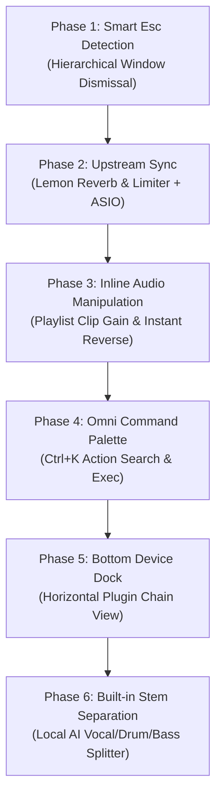

# Lemon Studio — Next-Gen DAW Roadmap

> **Snapshot Tag**: `v0.2.0-serum-v2`  
> **Commit**: `b6a4f94` (clean, verified green, pushed to `origin/main`)  
> **Date**: October 2026

---

## 1. Current State & Safety Checkpoint

All previous work is 100% committed, verified green across the 268+ test suite, compiled in release mode, installed to `~/.cargo/bin/lemonstudio`, and tagged as `v0.2.0-serum-v2`:
- **Lemon Wavetable (Serum V2 rebuild)**: Polyphonic 32-voice engine, 11-octave mipmapped anti-aliasing, 16-voice unison, phase warp modes (Sync, Bend, PWM, Asym, Flip), ZDF SVF filter, curved ADSR, vector LFO, and 760×540 HiDPI canvas editor.
- **Pattern Mixer Focus**: Middle-clicking any pattern in the toolbar or playlist picker focuses the mixer to only that pattern's active tracks, leaving Master and mastering racks untouched.
- **Clean Repo**: Zero uncommitted files; remote `origin/main` fully in sync.

---

## 2. Upstream Analysis (`ItsAlphaNeon/Lemon-Studio` at `6e9c3b9`)

Upstream has landed 13,500+ lines across several major PRs:
1. **Lemon Reverb (`plugins/lemon-reverb`)**:
   - Faithful recreation of FL Studio's *Fruity Reeverb 2* as a standalone CLAP/VST3 plugin and built-in mixer slot effect.
   - Includes room visualization, stereo diffusion, and decay damping.
2. **Lemon Limiter (`plugins/lemon-limiter`)**:
   - Faithful recreation of FL Studio's *Fruity Limiter* with visual scrolling oscilloscope, ceiling, saturation, and lookahead attack curve.
3. **Low-Latency Audio Engine**:
   - Native Windows ASIO driver support (with ASIO control panel popup).
   - Low-latency shared WASAPI and exclusive mode.
   - Render-ahead 3–6ms queued buffering.
4. **UI & Quality-of-Life Upgrades**:
   - Docked plugin windows on Linux no longer scroll background windows on wheel.
   - Buttons and menus fire on release.
   - Colorized playlist picker items by source with kind tab icons.

> [!NOTE]
> **Upstream Merge Strategy**:
> Because upstream added `crates/os-engine/src/effects/reverb.rs` and `dynamics.rs` while our fork previously added Dariacore/808 fx in `crates/os-engine/src/effects/`, merging requires carefully reconciling `effects/mod.rs` so that *both* upstream's Lemon Reverb and our fork's custom DSP tools coexist harmoniously. We will do this upstream sync as a focused step.

---

## 3. The 5-Phase Feature Roadmap

---

### Phase 1: Smart Esc Detection (Navigation & Dismissal Cascade)
*Priority: Immediate*
- **Problem**: In FL Studio and fast DAW workflows, hitting `Esc` should instinctively take you back to your main workspace without using the mouse to hunt for `✕` close buttons.
- **Hierarchical Esc Cascade**:
  1. **Level 1 (Popups & Overlays)**: If any context menu, rename box, dropdown, or modal dialog is open $\rightarrow$ close it.
  2. **Level 2 (Active Filters & Selections)**: If Pattern Mixer Focus is active OR notes/clips are selected $\rightarrow$ clear the filter / deselect.
  3. **Level 3 (Focused Plugin Windows)**: If a synth/FX window (`Lemon Wavetable`, `Lemon Ray`, EQ, etc.) is in front $\rightarrow$ close that window and drop focus back to Piano Roll or Channel Rack.
  4. **Level 4 (Sub-Windows to Main Workspace)**: If Mixer or Piano Roll is frontmost $\rightarrow$ close it and return focus to Channel Rack / Playlist.
- **Verification**: Unit tests simulating key sequences verifying window stack unwinding step-by-step.

---

### Phase 2: Upstream Synchronization
*Priority: High*
- Reconcile `crates/os-engine/src/effects/mod.rs` and `reverb.rs` so upstream's `Lemon Reverb` and `Lemon Limiter` are added to our built-in plugins list.
- Integrate upstream's low-latency audio queue improvements and picker UI icons.
- Run workspace test suite to ensure 100% green across all crates.

---

### Phase 3: Inline Audio Clip Manipulation (Playlist)
*Priority: High*
- **Clip Gain Overlay**:
  - Horizontal drag bar or corner handle on every audio clip waveform in the Playlist.
  - Dragging up/down adjusts clip gain directly in dB with live waveform height scaling, without needing to open the channel sampler settings.
- **Instant Reverse (`Shift+R` / Double Click Action)**:
  - Select an audio clip on the playlist and press `Shift+R` to immediately toggle waveform reversal in-place.
- **Quick Fade In / Fade Out Curves**:
  - Hovering top-left and top-right corners of audio clips displays curvature handles for click-free crossfades and fades.

---

### Phase 4: Omni Command Palette (`Ctrl+K`)
*Priority: Medium-High*
- **Global Shortcut**: Pressing `Ctrl+K` opens a sleek, centered floating search bar.
- **Fuzzy Search & Actions**:
  - `"add wavetable"` $\rightarrow$ Adds Lemon Wavetable channel.
  - `"quantize 1/16"` $\rightarrow$ Quantizes current piano roll notes.
  - `"bounce to audio"` $\rightarrow$ Renders selected pattern/track to an audio clip.
  - `"focus drums"` $\rightarrow$ Triggers pattern mixer focus.
  - `"theme lemon"` / `"theme citrus"` $\rightarrow$ Switches active skin.
- **Recents & Keybinding Hints**: Displays the shortcut key next to each action so users learn hotkeys naturally.

---

### Phase 5: Bottom Device Dock (Bitwig / Ableton Style)
*Priority: Medium*
- **Horizontal Chain Strip**:
  - A collapsible dock at the bottom of the screen showing the selected channel's complete signal chain:
    `[Instrument (Wavetable)] → [Slot 1: Parametric EQ] → [Slot 2: Lemon Reverb] → [Slot 3: Lemon Limiter]`.
- **Live Inline Controls**:
  - Tweak macro knobs, filter cutoffs, and wet/dry mix directly without popping open 4 separate floating plugin windows.

---

### Phase 6: Built-in Stem Separation (Local AI Model)
*Priority: Future Vision*
- **Workflow**: Right-click any audio file in the Browser or on the Playlist $\rightarrow$ *"Separate Stems"*.
- **Output**: Automatically splits into 4 synchronized playlist tracks:
  1. `[Vocals]`
  2. `[Drums]`
  3. `[Bass]`
  4. `[Instruments / Other]`
- **Engine**: Lightweight quantized local model running entirely on-device with zero external API dependencies.

---

## 4. Execution Plan & Next Immediate Step

1. **Commit & Tag Current Snapshot**: Done (`v0.2.0-serum-v2`, `b6a4f94`).
2. **Implement Phase 1 (Smart Esc Detection)**:
   - Wire the 4-level dismissal cascade into `crates/os-app/src/app.rs`.
   - Add unit tests verifying `Esc` cycles smoothly from plugin $\rightarrow$ piano roll $\rightarrow$ playlist.
   - Test and build.
